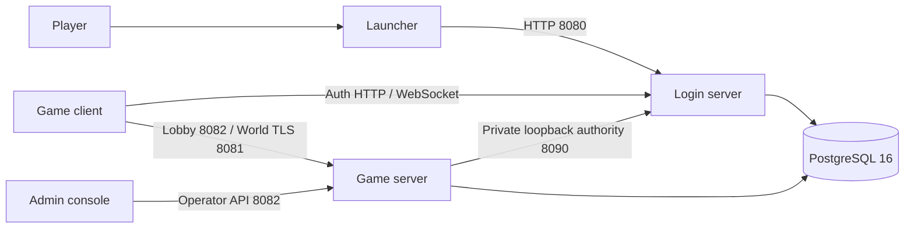

<p align="center"></p>

<h1 align="center">Project Chronicles</h1>

<p align="center">A community-built C++20 MMORPG emulator for the researched ArcheAge Chronicles demo.<br>Understand the game. Build the world. Make the behavior reproducible.</p>

<p align="center">
  
  
  
  
</p>

<p align="center"><a href="docs/guides/getting-started.md"><b>Get running</b></a> · <a href="docs/progress.md"><b>Feature progress</b></a> · <a href="docs/guides/game-data.md"><b>Extract game data</b></a> · <a href="CONTRIBUTING.md"><b>Contribute</b></a> · <a href="docs/README.md"><b>Documentation</b></a></p>

---

## A world under construction

Project Chronicles separates authentication, world simulation and desktop tools into
four independently built projects. This repository is the game server and the main
entry point for project documentation.

The emulator contains stateful gameplay systems, persistent characters, native
protocol adapters and automated checks. It is still an **experimental, build-specific
emulator**. A packet handler or passing synthetic test does not mean the corresponding
game system is complete. The [progress guide](docs/progress.md) makes those distinctions visible.

## Four projects, one development environment

| Project | Owns | Local endpoint | Start here |
| :--- | :--- | :--- | :--- |
| **[Login server](https://github.com/Project-Chronicles-Emulator/login-server)** | Accounts, sessions, launcher grants and world admission | HTTP `8080`; private `8090` | [Login guide](docs/guides/components.md#login-server) |
| **[Game server](https://github.com/Project-Chronicles-Emulator/game-server)** | Characters, gameplay, world simulation and operator API | HTTP `8082`; world TLS `8081` | [Game guide](docs/guides/components.md#game-server) |
| **[Launcher](https://github.com/Project-Chronicles-Emulator/launcher)** | Player sign-in, game selection, startup and signed distribution | Connects to login | [Launcher guide](docs/guides/components.md#launcher) |
| **[Admin](https://github.com/Project-Chronicles-Emulator/admin)** | Operator desktop console and server management | Connects to game | [Admin guide](docs/guides/components.md#admin) |



The current split supports **one login and one game process on the same host and
database**. Each checkout includes its own source dependencies; no sibling source
folder is required to compile a component.

## Generate your own research inputs

These separate repositories publish tooling source only:

| Tool | Purpose |
| :--- | :--- |
| [**SDK generator**](https://github.com/Project-Chronicles-Emulator/sdk-generator) | Generate and validate reflection/C++/Lua SDK output from your compatible local client |
| [**Asset extractor**](https://github.com/Project-Chronicles-Emulator/asset-extractor) | Extract local archives, recover descriptors and build verified catalogs |

Client files, generated game SDKs, extracted assets, captures and keys are supplied
or produced locally and are not distributed in those repositories.

## Your first successful run

**Prepare tools → build → install the database → configure private keys and TLS →
start login → start game → open launcher and admin.**

```powershell
git clone https://github.com/Project-Chronicles-Emulator/game-server.git
git clone https://github.com/Project-Chronicles-Emulator/login-server.git
git clone https://github.com/Project-Chronicles-Emulator/launcher.git
git clone https://github.com/Project-Chronicles-Emulator/admin.git
```

The **[complete local setup](docs/guides/getting-started.md)** includes prerequisites,
copyable build commands, database installation, secret configuration, certificate
creation, startup order and health checks. Client files and credentials are supplied locally.

> **Choose the right milestone.** Service smoke tests validate login, sessions and
> transport before gameplay data is prepared. Playing the researched client also
> requires a compatible local client, generated data and the applicable client setup.
> The service split has synthetic acceptance; original-client gameplay after that
> split has not yet been revalidated.

## Where development stands

| Area | Current foundation | Remaining work |
| :--- | :--- | :--- |
| Login & characters | Persistent accounts, sessions, grants and owned selection | General platform authentication and client acceptance after the split |
| Movement & world | Checkpoints, nearby presence and bounded tutorial travel | General travel, navigation and broader world authority |
| Combat & skills | Server action timing, costs, cooldowns and supported damage/effects | Full defence/effect semantics, broader combat and client acceptance |
| Quests & interactions | Supported stateful objectives, guarded rewards and tutorial interactions | Complete content coverage and broader playthroughs |
| Gathering & crafting | Supported source/claim flows and catalog-driven processing | Remaining recipes, source policies and full parity |
| Housing | Land/channel/object foundations and supported owned-state flows | Remaining lifecycle behavior and client acceptance |
| Economy & social | Inventory, loot, trade, marketplace and social foundations | See each feature's exact scope and evidence |

**[Open the full feature matrix →](docs/progress.md)**

The canonical inventory tracks **538 message/route entries**. These are recovered
contracts, not a completion percentage. Feature status, packet status, static research,
captures, synthetic checks and client observations are recorded separately in the
[protocol reference](docs/protocol-feature-reference.md).

## Build something useful

| If you want to… | Read this |
| :--- | :--- |
| Run all four components | [Getting started](docs/guides/getting-started.md) |
| Understand ownership and configuration | [Component guide](docs/guides/components.md) |
| Extract archives and generate server data | [Game data pipeline](docs/guides/game-data.md) |
| Find the code responsible for a behavior | [Architecture and source map](docs/guides/architecture.md) |
| Implement a feature or fix a bug | [Contribution workflow](docs/guides/feature-workflow.md) |
| Choose checks and report results | [Testing and evidence](docs/guides/testing.md) |
| Diagnose a failed setup | [Troubleshooting](docs/guides/troubleshooting.md) |

Start with [CONTRIBUTING.md](CONTRIBUTING.md). A useful contribution includes a clear
behavioral contract, a focused implementation and evidence another contributor can
reproduce. Documentation, extraction fixes and scoped bug reports are welcome too.

---

<p align="center"><a href="https://github.com/Project-Chronicles-Emulator">Organization</a> · <a href="https://github.com/Project-Chronicles-Emulator/game-server/issues">Issues</a> · <a href="docs/service-split-validation.md">Validation record</a></p>

<p align="center"><sub>Independent community project. Not affiliated with or endorsed by the game's creators or publishers.</sub></p>

## Preview downloads and reproducible releases

The **Actions → Release preview** workflow builds a Windows x64 package from a
clean checkout and creates a draft prerelease with its SHA-256 checksum. Choose a
new `vMAJOR.MINOR.PATCH-preview.NUMBER` tag when dispatching it. A failed build does
not create a release. Published previews appear on this repository's Releases page.

Packages contain the application and selected support files only. They include no
client installation, extracted game data, archive keys or credentials. Keep the whole
package together; follow the setup instructions above before starting it. Windows
C++ applications require the Microsoft Visual C++ x64 runtime; desktop interfaces
also require Microsoft Edge WebView2 Runtime. The extractor package requires .NET 10.
These experimental previews do not establish compatibility with another client build.

See [build inputs and complete recovered packet fields](docs/guides/protocol-inputs.md) for the checked-in schemas and readable field export.
