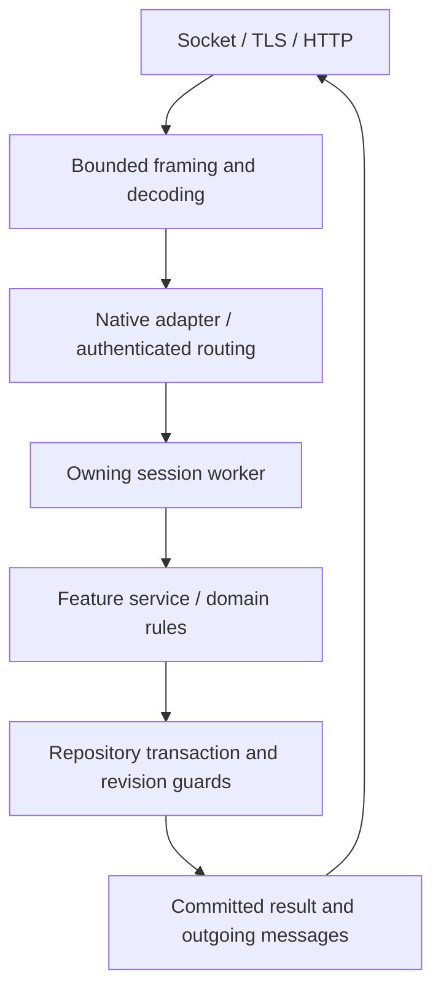

# Architecture and source map

[← Documentation](../README.md) · [Contribution workflow](feature-workflow.md)

## The path from a request to saved state



Transport validates framing and sizes. Routing establishes authenticated identity.
The owning feature validates map/instance, ownership, range, state and catalog
rules. Persistent effects commit before success is sent. Socket continuations must
not wait on a database transaction, private login RPC or another session worker.

## Game repository map

| Path | Responsibility | Start here when… |
| :--- | :--- | :--- |
| `src/apps/` | Process startup, repositories, ownership leases and orchestration | A service fails to start or a lifetime is wrong |
| `src/auth/` | Shared auth/lobby types and private authority integration | A session, grant, character selection or admission fails |
| `src/net/` | Framing, bounded socket queues, TLS and connection lifecycle | Bytes, deadlines, backpressure or connection ordering are wrong |
| `src/protocol/` | Protocol encoding/decoding utilities | Payload/frame handling differs from recovered contracts |
| `src/data/` | Verified catalog loading and static definitions | CMS rows, types or hash validation are wrong |
| `src/persistence/` | Account/character repositories and atomic world storage | State is lost, duplicated or committed out of order |
| `src/world/core/` | Shared world contracts and routing foundations | A concern spans several world features |
| `src/world/features/<feature>/` | Feature-owned behavior, models and tests | Implementing or fixing gameplay |
| `src/world/session/` | Native world session composition and ordered execution | Cross-feature ordering, entry or disconnect behavior is wrong |
| `src/services/` | Front, admin, social, distribution-related HTTP and optional services | An adapter/API contract is wrong |
| `protocol/` | Versioned descriptors, opcodes, feature coverage and sanitized observations | Checking what is actually recovered or supported |
| `migrations/001_accounts_characters.sql` | Complete current fresh-install schema | A storage contract needs schema support |
| `tools/` | Extraction, generators, verification and build helpers | Preparing data or maintaining generated references |

`cmake/ChroniclesModules.cmake` defines module/test conventions. A module's
`CMakeLists.txt` records its sources and direct dependencies. `tools/source_layout.json`
describes layering; do not solve a dependency cycle with an umbrella include or a
new sibling-repository source dependency.

## Find a feature before editing

```powershell
rg -n 'CharSelectReq|CharSelectRes' src protocol
rg --files src/world/features/gathering
rg -n 'reserve|commit|revision' src/persistence/loot_claim_storage.cpp
```

Read the [feature reference](../protocol-feature-reference.md), then the owning
feature source, its repository methods and its tests. A packet name may appear in
a schema, adapter and runtime service; those appearances establish different things.
The main native session composes behavior. Prefer changing the owning feature
rather than accumulating unrelated logic in that composition layer.

## Three boundaries contributors must preserve

### Ownership and authorization

Derive account and selected character from an authenticated session. Check ownership
again at storage/service boundaries. Client-supplied IDs, quantities, destinations,
timestamps and hit reports are inputs to validate, not authority to grant effects.
Login owns authentication state; game owns character/world behavior.

### State and persistence

Memory repositories are useful for disposable tests, not durability proof. Persistent
effects use parameterized SQL, transactions and existing revision/ownership guards.
A reward must not be sent before its inventory, consumed marker and quest state
commit together. Retry, reconnect and lost acknowledgement are part of the contract.

### Execution and lifetime

Keep each session's mutations ordered on its worker/strand. Do not hold the protocol
codec lock while doing I/O. Bound queues, request sizes, object counts and rates.
Do not capture raw pointers into asynchronous work whose owner may disconnect.
Use existing shutdown/drain and character-admission gates instead of adding a second
competing lifecycle mechanism.

## Data is a separate layer

Recovered client CMS rows describe static content. Captures show observed behavior.
Server domain code chooses and validates supported behavior. Those layers must not
be collapsed into a claim that an indexed row or decoded packet implements gameplay.
See [game-data.md](game-data.md) for the reproducible pipeline and build identity checks.
